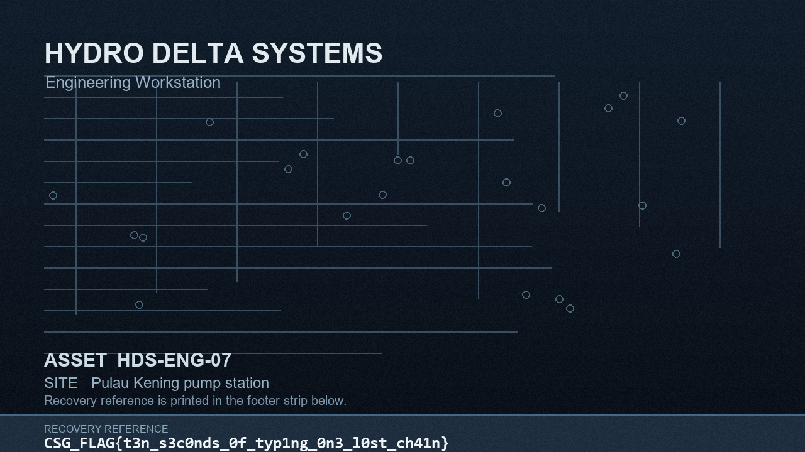

# BadUSB Case

The workstation collection contains three `.lockd` files, a ransom notice, a replacement background, a process-creation export, and a manifest. The USB image contains the program that sealed the files, but its staging directory is absent from the normal directory listing. Recovering that program is only half the job: a TLS callback changes its cipher constants before `main`, so a direct translation of the constants visible on disk produces the wrong key.

The recovered login background displays:

```text
CSG_FLAG{t3n_s3c0nds_0f_typ1ng_0n3_l0st_ch41n}
```



This writeup starts with the supplied `badusb_case.zip`. The [solver](files/solve.py) uses only the Python standard library. It reads the image, recovers the executable, derives the key, and restores all three sealed files without running the Windows executable.

## 1. Establish the evidence and disk layout

Extract the archive into a working directory and verify the image against its supplied checksum:

```bash
unzip badusb_case.zip -d badusb_case
cd badusb_case
sha256sum -c HDS-USB01.dd.sha256
file HDS-USB01.dd
mmls HDS-USB01.dd
```

The image is 536,870,912 bytes. Its SHA-256 is `62dac5eb80935f13cd06a3f644275ddff28b95faceddef0fa1801be9dc05dd7d`, matching the `.sha256` file. The MBR contains one FAT32 partition starting at sector 2048. All recovery below reads the image; no filesystem repair or writable mount is needed.

The partition parameters are useful later:

| Value | Result |
| --- | --- |
| Partition start | Sector 2048, raw offset `0x100000` |
| FAT32 reserved sectors | 32 |
| FAT0 start | Raw offset `0x104000` |
| FAT32 data area | Filesystem sector 2074, raw offset `0x203400` (`2,110,464`) |
| Cluster size | 4096 bytes |
| Root directory | Cluster 2 |

These come from `fsstat -o 2048 HDS-USB01.dd`. Sleuth Kit's `-o` value is in sectors, while the raw offsets above are in bytes. The start of cluster `n` is:

```text
2,110,464 + (n - 2) × 4096
```

## 2. Follow the USB configuration into the orphaned directory

List the FAT32 tree and extract its visible configuration:

```bash
fls -r -p -o 2048 HDS-USB01.dd
icat -o 2048 HDS-USB01.dd 3
```

The listing contains promotional photos, firmware, example scripts, and `FL9.CFG`. It does not contain `FWSTAGE`. The configuration supplies a lead that the listing does not:

```ini
script_store=reserved
script_bytes=15600
payload=\FWSTAGE\PRN_DRV.BIN
payload_bytes=106528
stealth=1
```

The payload name appears in a directory structure still present in raw cluster data. At raw offset `2,487,296`, the directory's `.` and `..` entries remain; at `2,487,360`, its 32-byte file entry contains the FAT short name `PRN_DRV BIN`. That entry specifies start cluster 43 and size 106,528 bytes. The directory is cluster 94 because `2,110,464 + (94 - 2) × 4096 = 2,487,296`. The parent entry was removed, which is why ordinary `fls` recursion did not reach it.

Cluster 43 begins at raw offset `2,278,400`. The FAT chain is still intact:

```text
43 44 45 46 47 48 56 57 58 59 60 61 69 70 71 72 73 74
82 83 84 85 86 87 88 89 90
```

It has 27 clusters. The gaps matter: reading 106,528 bytes contiguously from cluster 43 would mix in other files. The solver follows each 28-bit FAT entry, joins the 4096-byte clusters, and trims to the size in the directory entry.

The reconstructed file begins with `LKD1`. Its first 32 bytes are a wrapper:

| Offset | Meaning | Value |
| --- | --- | --- |
| `0x00` | Magic | `LKD1` |
| `0x04` | Decrypted length, little-endian `u32` | 106,496 |
| `0x10` | RC4 key, 16 bytes | `3fa9c1750e6b84d2a70f5c1938e2b6a4` |
| `0x20` | RC4 ciphertext | Windows executable bytes |

The FAT file length is exactly 32 + 106,496. RC4 decryption produces an `MZ` header and a PE32+ x86-64 console executable. Its SHA-256 is `7ab789767b932f4d2f425ddb96476356cc031e50d9960afaa858c58b6466f7b5`. The solver verifies this hash before using the PE. It does not execute the file.

## 3. Read the pre-partition keyboard script

The configured script is before the partition, at raw sector 1. The first 32 bytes start with `HIDQ`; the 15,600 bytes after them consist of eight-byte HID keyboard reports. In each report, byte 0 is the modifier field and byte 2 is the first key usage. For example, `08 00 15 ...` is GUI+R, and Shift is selected by `modifier & 0x22`. Tracking key-down transitions avoids emitting held keys twice.

The meaningful portion of the reports describes this operation (normalized pseudocode, not a byte-for-byte PowerShell transcript):

```powershell
$b = [IO.File]::ReadAllBytes('D:\FWSTAGE\PRN_DRV.BIN')
$key = $b[16..31]
$length = [BitConverter]::ToUInt32($b, 4)
$program = RC4($b[32..(31+$length)], $key)
[IO.File]::WriteAllBytes("$env:TEMP\prnupd.exe", $program)
& "$env:TEMP\prnupd.exe" -d \\.\PHYSICALDRIVE1 -t <one-file> -i 'NX7-2R8QF4KD9T'
```

This explains both the `LKD1` wrapper and the SIEM rows: elevated PowerShell starts `prnupd.exe` from the user's Temp directory with `-d \\.\PHYSICALDRIVE1` and a `-t` target. The export truncates the target command lines, so the HID reports are the source for the campaign identifier. The binary's argument parser accepts one target path and has no directory walk; the separate process-creation rows correspond to separate invocations.

## 4. Map the executable's input and output

Static analysis of the recovered PE gives the important calls and data flow:

| Virtual address | Role |
| --- | --- |
| `0x140001000` | TLS callback mutating round constants on process attach |
| `0x1400011a0` | Build the 16-byte campaign key |
| `0x1400014f0` | Encrypt a target's initial whole blocks with CBC chaining |
| `0x140001790` | Compress one full block into the custom hash state |
| `0x1400018c0` | 16-byte block cipher |
| `0x140001aa0` | Custom 128-bit hash, including padding and length finalization |
| `0x140001d90` | Expand block-cipher round keys |
| `0x140001fa0` | Parse `-d`, `-t`, `-i`, read device sectors, and write `.lockd` |

`main` reads sector 0 of the device and checks the MBR signature. It takes the partition start from the MBR, reads that partition's FAT32 boot sector, then reads raw sector 1 for `HIDQ`. The key inputs are:

```text
HIDQ bytes at raw offsets 520..535 : 5a1f0c93ee47b2d80148a6cf3b91d27e
FAT32 volume ID at boot + 0x43   : 921e4a7c (four on-disk bytes)
Campaign identifier                : NX7-2R8QF4KD9T (ASCII, no terminator)
Recovered executable              : all 106,496 bytes
```

The executable's own file bytes are hashed first. Then `0x1400011a0` hashes the concatenation of the HIDQ seed, four volume-ID bytes, 16-byte executable digest, and ASCII identifier. The output is the file-encryption key. The executable digest and key, after correct initialization, are:

```text
executable digest: 79850f8b25478649341e0130fb8f6401
campaign key:      b8e4563dd09366d360e772249526377f
```

## 5. Account for the TLS callback before modeling the cipher

The first attempt to model the block cipher directly from `.data` decrypted every file to garbage and failed every trailer CRC32. The hash and block-cipher translations agreed with direct emulation of their functions, so the discrepancy was in process state rather than in those translations.

The cross-reference that resolves it is a write to the constant table at `0x140019000`. The routine at `0x140001000` is a TLS callback. When its reason argument is process attach (`EDX = 1`), it obtains the loaded PE header's TimeDateStamp and runs a 32-bit linear congruential generator:

```python
state = pe_timestamp  # 0x6a55f3cb
for i in range(22):
    state = (state * 0x19660d + 0x3c6ef35f) & 0xffffffff
    live_constants[i] = disk_constants[i] ^ state
```

The first table entry changes from `0xd4595925` on disk to `0x649b6f8b` in the process. The next three live entries are `0x62226775`, `0x7d04477f`, and `0x28d6c043`. The callback changes 22 dwords, while the key schedule consumes the first 21 to generate 22 round keys, counting its initial key word. Applying these writes changed the executable digest and campaign key to the values above. It also made all three file checks pass.

The cipher operates on two little-endian 64-bit words. With 64-bit wraparound, `C[i]` as the initialized 32-bit constant, and `K[0], L[0]` from a 16-byte key block, its expansion is:

```text
L[i+1] = (ROR64(L[i], 8) + K[i]) XOR C[i]
K[i+1] = ROR64(K[i], 61) XOR L[i+1]        for i = 0..20
```

The 22 encryption rounds are:

```text
X[i+1] = (ROR64(X[i], 8) + Y[i]) XOR K[i]
Y[i+1] = ROR64(Y[i], 61) XOR X[i+1]        for i = 0..21
```

This is a Speck-like ARX construction. The inverse used by the solver applies the rounds in reverse order:

```text
Y[i] = ROL64(Y[i+1] XOR X[i+1], 61)
X[i] = ROL64((X[i+1] XOR K[i]) - Y[i], 8)
```

The custom 128-bit hash starts at two fixed 64-bit words, `0xa2de40f113e09aa5` and `0x3b008f876c3f3b4d`. For each full 16-byte input block it encrypts the current state with that block as the cipher key, then XORs the encrypted state into the previous state. It processes one padded block containing the remaining bytes and `0x80`, even when the input length is a multiple of 16. A final block is `<u64 original_length, u64 0x07c8f4142d06dd90>`. These byte orders and the extra finalization are required for the executable digest, campaign key, and per-file IVs to match.

## 6. Parse `.lockd` and restore the files

The program encrypts only the initial whole blocks of each file, capped at `0x40000` bytes (262,144). It appends a 40-byte trailer; the original file bytes before the trailer keep their length. The trailer layout is:

```text
offset  size  field
0x00      4   LKD7 magic
0x04      4   version = 1
0x08      4   encrypted prefix length
0x0c      8   original file size
0x14      4   CRC32 of the original plaintext
0x18     16   per-file digest / CBC IV
```

The IV is independently reproducible. The program hashes the original size as a little-endian `u64` followed by the target's uppercased basename in single-byte ASCII. For `lockscreen.bmp`, the basename is `LOCKSCREEN.BMP`, so:

```python
iv = hash128(struct.pack('<Q', 2764854) + b'LOCKSCREEN.BMP')
# d058d5a92844eefb7366944a3962da31
```

The sealed files' trailer values are:

| Original basename | Size | Encrypted prefix | Stored CRC32 | Stored IV |
| --- | ---: | ---: | --- | --- |
| `OPS_HANDOVER.TXT` | 741 | 736 | `a79fc2f8` | `71184fb5a656176762942816e1f459d7` |
| `SHIFT_ROSTER.CSV` | 325 | 320 | `b047d5a3` | `1780516a1ed587ac516cbe1196c32a33` |
| `LOCKSCREEN.BMP` | 2,764,854 | 262,144 | `35a22ee5` | `d058d5a92844eefb7366944a3962da31` |

For each encrypted block, save its ciphertext, invert the block cipher under the campaign key, XOR with the previous ciphertext (or the IV for block zero), then advance the chaining value. The remainder after the encrypted prefix is copied as-is. The solver checks the per-file IV formula before decryption and CRC32 afterward.

The partial-encryption cap explains a useful visual clue. A 1280×720, 24-bit BMP has 3840 bytes per pixel row and stores rows bottom-up. The 262,144-byte encrypted prefix covers the BMP header and roughly 68 bottom rows. Most of the background could be previewed from unchanged bytes; the footer strip containing the recovery reference remained encrypted. The preview located the text but did not reveal it. Successful decryption restored that strip and the BMP header.

## 7. Reproduce and verify the recovery

Save the [solver](files/solve.py) as `solve.py` in the directory containing `HDS-USB01.dd` and `victim/`, then run:

```bash
python3 solve.py
file work/prnupd.exe work/C_ProgramData_HDS_Branding_lockscreen.bmp
sha256sum work/prnupd.exe work/C_ProgramData_HDS_Branding_lockscreen.bmp
```

The solver creates `work/` and prints the initialized executable digest, campaign key, and each file's computed and stored CRC. In the verified run, all three pairs matched:

```text
LOCKSCREEN.BMP   0x35a22ee5 = 0x35a22ee5
OPS_HANDOVER.TXT 0xa79fc2f8 = 0xa79fc2f8
SHIFT_ROSTER.CSV 0xb047d5a3 = 0xb047d5a3
```

The recovered executable and BMP hashes are:

```text
7ab789767b932f4d2f425ddb96476356cc031e50d9960afaa858c58b6466f7b5  work/prnupd.exe
2ae2652a40498248c0ca92ad4715cc0c695c3a4ee7cffcd07151d2f0a4b59d32  work/C_ProgramData_HDS_Branding_lockscreen.bmp
```

The BMP parser identifies the result as a 1280×720, 24-bit Windows bitmap. Its footer visibly prints the flag quoted at the start. This is a visual transcription from the CRC-validated recovered file; it is not a string extracted from the sealed bytes.
