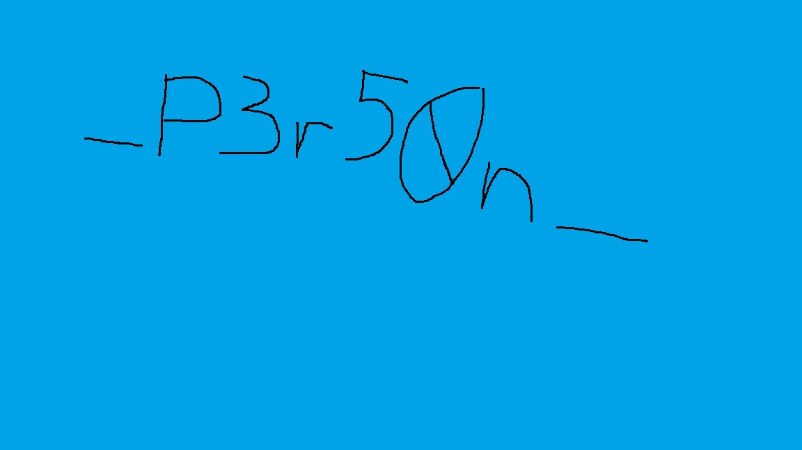

# What Did You Type

[Download solver](files/solve.py)

The archive contains two PCAPs: one records USB keyboard traffic, and the other records files being uploaded over HTTP. The supplied `PbWE.txt` is a Base64-encoded encrypted ZIP containing the program responsible for the upload.

The recovered flag is:

```text
CMO{Dumb357_P3r50n_1n_7h3_M1lky_W4y_!!!}
```

It is split between an XLSX cell, handwriting in a JPG, and a DOCX watermark. All three files were recovered from the network capture. The JPG fragment was read visually; the solver labels that transcription rather than pretending to perform OCR. The result also matches the repository author's published flag.

## 1. Identify the supplied evidence

Repository: [crackmesone/ctf-2026-challenges-public](https://github.com/crackmesone/ctf-2026-challenges-public), commit `5f8857cf3556e4e36d7e7fc4650044ae682701b8`.

The files are under `What did you type/Handout/`:

| File | SHA-256 |
| --- | --- |
| `chall.zip` | `425e58419c3b76d47ab7973c95d26b172b670a7917fe4be100c5c4a743b764a0` |
| `PbWE.txt` | `cb3854b84b78259d09272cf2cb188f586bc422313b4035325e4f2ad9dff86f8d` |

Extract the challenge archive using `crackmes.one`:

```bash
7z x -pcrackmes.one chall.zip -owork
file work/*
```

The names are misleading if considered without their file types:

```text
monitor_hardware: pcap capture file, USB with USBPcap header
monitor_network:  pcap capture file, Ethernet
```

`monitor_hardware` has 61,760 packets and SHA-256 `dc1de2d5f8f6a5d7fbc4275e6a77a15203a7c77eb977185a03b5a8e1413e67f2`. `monitor_network` has 110 packets and SHA-256 `16967eb56744af0b3eae055686a3d9f6aa04c6b0ce542cf15ec8b1059b12e9dc`.

The two captures have different dates. Do not merge their timestamps into a single precise incident timeline without additional evidence. The useful relationship here comes from the commands, program, and upload behavior.

## 2. Read the USB keyboard reports

List interrupt transfers carrying eight-byte reports:

```bash
tshark -r work/monitor_hardware \
  -Y 'usb.transfer_type==0x01 && usb.data_len==8' \
  -T fields -e frame.number -e usbhid.data
```

The initial rows include:

```text
75      0000000000000000
1383    0000130000000000
1411    0000000000000000
1459    0000120000000000
1487    0000000000000000
1547    00001a0000000000
```

For these boot-keyboard reports, byte 0 contains modifier bits, byte 1 is reserved, and bytes 2–7 contain pressed usage codes. Usage `0x13` is `p`, `0x12` is `o`, and `0x1a` is `w`. Left or right Shift is detected by `modifier & 0x22`.

Track the set of held keys and emit only newly pressed usages. The all-zero reports release the keys; emitting every report as a character would produce duplicates or meaningless nulls. Tab completion means the capture does not contain the fully expanded shell commands, so preserve Tab and editing keys in the transcript.

The decisive command is readable after decoding:

```text
unzip -P 1m_g0d_!! sus.z<TAB> -d out
```

The transcript also contains a download of `https://0x0.st/PbWE.txt`, writing it to `sus.zip`, extracting it, and running the recovered module. The captured password is therefore:

```text
1m_g0d_!!
```

There is no reason to contact the historical URL. The repository already supplies `PbWE.txt`.

## 3. Decode the supplied download

Decode the Base64 file and list the resulting archive:

```python
import base64
from pathlib import Path

Path("PbWE.zip").write_bytes(base64.b64decode(Path("PbWE.txt").read_bytes()))
```

It contains one password-protected entry, `module.exe`, 74,240 bytes long. Use the USB password:

```bash
7z x '-p1m_g0d_!!' PbWE.zip -omodule
file module/module.exe
sha256sum module/module.exe
```

Output identifies a native Windows x64 PE. Its SHA-256 is:

```text
1dd277512b952429580eea0cbd1b07299137630daca837f28a79e436edb7d703
```

The rest of the analysis is static. No recovered executable is launched, and none of its network endpoints are contacted.

## 4. Export the HTTP bodies

Use HTTP reassembly rather than concatenating raw TCP packets yourself:

```bash
tshark -r work/monitor_network -Y http \
  -T fields -e frame.number -e http.file_data
```

`http.file_data` is printed as hex. Decode each nonempty field with `bytes.fromhex()`.

The important bodies are:

| Frame | Body |
| --- | --- |
| 8 | 32-byte response to the initial GET |
| 16 | `Cool_Story.docx` |
| 32 | 20,548-byte encrypted upload |
| 43 | `hello_darkness_my_old_friend.txt` |
| 54 | 180-byte encrypted upload |
| 65 | `IDK_why_I_saved_this.xlsx` |
| 77 | 10,052-byte encrypted upload |
| 88 | `sexy_picture.jpg` |
| 103 | 33,524-byte encrypted upload |

The server's repeated `You good bro !!` responses acknowledge the uploads; they are not file contents or keys.

The initial GET response contains:

```text
66c9c5a2015ff2be075f3d430031f54d22f8ad7194363889a019350937946d74
```

This becomes useful when tracing the loader.

## 5. Extract the loader's encrypted resource

The loader's `main` begins at `0x140003cc0`. It hashes `GetComputerNameA()`'s result and compares the hash against the 32-byte value obtained by a GET to `for-ultramar.com:9999`.

The network capture gives us the response directly, so there is no need to recover the original hostname. At `0x140003e43`, the loader selects a fixed IV at `0x14000a078`, expands the 32-byte hash as an AES key, and decrypts its resource.

The resource lookup routine at `0x140003a50` calls:

```c
FindResourceA(NULL, 254, 255);
```

Resource type 255, name 254, contains 36,576 encrypted bytes. Its IV is:

```text
0f0e0d0c0b0a09080706050403020100
```

Decrypt it with AES-256-CBC using the captured GET response as the key. The resulting data begins with x64 instructions rather than an `MZ` header. It is shellcode carrying another serialized loader and its arguments. Removing valid PKCS#7 padding leaves 36,570 bytes.

The included solver has a small PE resource reader and performs this extraction directly from the file. It does not load the PE as a Windows process.

## 6. Skip the serialized flat program and decode its arguments

The shellcode contains a call/pop accessor at offset `0xc60`:

```asm
call    next
next:
pop     rax
add     rax, 8
ret
```

It returns offset `0xc6d`, where the serialized data starts. The four-byte program length is 10,987. The next object, immediately after that program, is a length-prefixed argument blob of 22,394 bytes.

This is why we do not need to execute the flat program or repair all its relocations merely to recover the next payload. Its argument parser tells us the data layout:

```text
u32 mode                 = 0
u32 decoded_length       = 22035
u32 encrypted_length     = 22035
encrypted bytes
u32 xor_key_length       = 343
XOR key bytes
```

In the embedded flat program, routine offset `0x336` XORs each data byte with `key[index % key_length]`. Mode 0 selects a copy path instead of `RtlDecompressBuffer`, so no decompressor is needed for this sample.

Applying the repeating XOR produces another serialized object:

```text
length-prefixed label
length-prefixed PE image
```

The second object is a 22,016-byte native executable. Its SHA-256 is:

```text
2b0231e9a67a15e8e3d3bdc704209f71391794d4e99181334fa6b9cccd8d3c6a
```

This is the actual file collector. Keep it as analysis evidence; it is not necessary to run it.

## 7. Recover the per-file encryption format

The recovered collector's `main`, at `0x140002560`, enumerates the current directory and selects filenames containing `.txt`, `.doc`, `.docx`, `.xls`, `.xlsx`, `.png`, or `.jpg`.

Its file-encryption routine starts at `0x140002240`. It seeds the MSVC PRNG with time, takes the low byte of four `rand()` results, and hashes those four bytes with SHA-256. At `0x1400023ed`, it uses that digest as its AES-256 key and the same descending-byte IV at `0x140006078`.

After padding and encrypting the file, it prepends the original four random bytes to the upload. The complete format is:

```text
random_prefix[4] || AES-256-CBC(SHA256(random_prefix), fixed_IV, PKCS7(file))
```

That explains why every encrypted upload length is four more than a multiple of 16. The key derivation input is sent in the clear. We do not need to brute-force time or reproduce `rand()`.

For one recovered HTTP body:

```python
import hashlib
from Crypto.Cipher import AES
from Crypto.Util.Padding import unpad

prefix = upload[:4]
key = hashlib.sha256(prefix).digest()
iv = bytes(range(15, -1, -1))
padded = AES.new(key, AES.MODE_CBC, iv).decrypt(upload[4:])
original_file = unpad(padded, 16)
```

All four uploads decrypt with valid padding and the expected file signatures:

| File | Plaintext size | SHA-256 |
| --- | --- | --- |
| `Cool_Story.docx` | 20,540 | `092a9ee7afa930f95431b58be845d5ef4ceca4fd8e25c2757ce439d9cfa18068` |
| `hello_darkness_my_old_friend.txt` | 165 | Recorded in the solver's manifest |
| `IDK_why_I_saved_this.xlsx` | 10,045 | `192c686409fd9bbeffb23a885294b62bd69404a02cbc0f9d435a6977da27a6d2` |
| `sexy_picture.jpg` | 33,504 | `d7beee47670013a19417e4d7bc5e9a548b3aad8fb1bd137650cc0dc56bc24825` |

The solver also re-encrypts the padded plaintext and compares it to the captured ciphertext before writing the recovered file.

## 8. Read the three flag fragments

DOCX and XLSX files are ZIP containers. Inspect the contents instead of relying on what an office application's normal document view happens to display.

In `IDK_why_I_saved_this.xlsx`, `xl/sharedStrings.xml` contains:

```xml
<si><t>CMO{Dumb357</t></si>
```

The recovered `sexy_picture.jpg` displays the middle fragment:



Read it as `_P3r50n_`, including both underscores. This is a visual transcription, not a strings extraction.

In `Cool_Story.docx`, the main body is a distraction. The missing suffix is in `word/header2.xml`, as a VML text-path attribute used for a watermark:

```xml
<v:textpath ... string="1n_7h3_M1lky_W4y_!!!}"/>
```

Extracting only `<w:t>` elements from `word/document.xml` misses this attribute completely. Search headers, drawings, attributes, and other ZIP members when the visible document body has no useful result.

Concatenate the spreadsheet, image, and watermark fragments:

```text
CMO{Dumb357 + _P3r50n_ + 1n_7h3_M1lky_W4y_!!!}
```

Result:

```text
CMO{Dumb357_P3r50n_1n_7h3_M1lky_W4y_!!!}
```

## 9. Reproduce the extraction

Install Wireshark's `tshark` command and PyCryptodome in your analysis environment. Save the accompanying `solve.py` and point it at the repository root:

```bash
python -m venv .venv
source .venv/bin/activate
python -m pip install pycryptodome
python solve.py /path/to/ctf-2026-challenges-public --out recovered
```

The solver reads the archive password from USB evidence, extracts the downloaded module, obtains the loader key from HTTP frame 8, statically unwraps the payload, decrypts the four files, and reads the XML fragments. It uses the documented visual transcription for the JPG, configurable with `--image-fragment`.

Its final output is:

```text
ZIP password from USB: 1m_g0d_!!
Recovered frame 32: Cool_Story.docx (20540 bytes)
Recovered frame 54: hello_darkness_my_old_friend.txt (165 bytes)
Recovered frame 77: IDK_why_I_saved_this.xlsx (10045 bytes)
Recovered frame 103: sexy_picture.jpg (33504 bytes)
XLSX fragment: CMO{Dumb357
JPG fragment (manual transcription): _P3r50n_
DOCX fragment: 1n_7h3_M1lky_W4y_!!!}
CMO{Dumb357_P3r50n_1n_7h3_M1lky_W4y_!!!}
```

This was reproduced from a fresh extraction of the supplied ZIP. No live C2 server or execution of the recovered collector is required.
